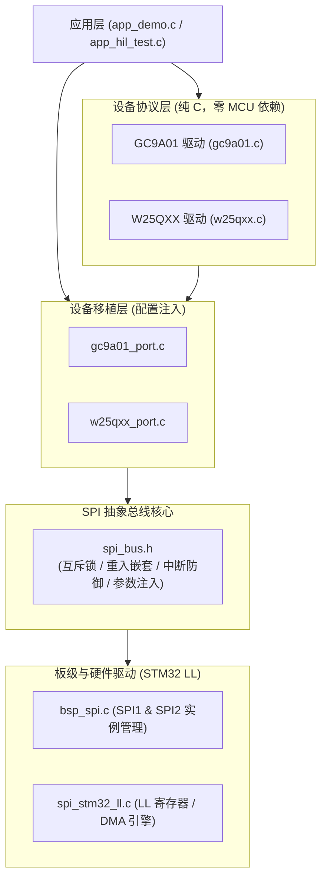

# STM32F103 双 SPI 驱动与交互式 Demo (GC9A01 TFT + W25Q128 Flash)

[](https://github.com/Crazypsy92/stm32f103-gc9a01-w25qxx-spi-bus/actions/workflows/host-tests.yml)
<!-- 项目许可证尚未确定；正式发布前需按原始依赖许可选择并添加 LICENSE。 -->
[](https://www.st.com)
[]()

本项目是面向 **STM32F103C8T6**（Cortex-M3，72MHz，64KB Flash / 20KB SRAM）的开源裸机外设驱动工程。工程采用分层解耦架构，实现了 **双独立硬件 SPI 外设（SPI1 + SPI2）与 DMA** 同时驱动 **GC9A01 240×240 圆形彩色液晶屏** 与 **W25Q128 16MB NOR Flash 存储芯片**，并配备专为圆屏设计的单按键交互式演示程序（Interactive Demo）。

---

## 目录

1. [项目特性](#一项目特性)
2. [硬件环境](#二硬件环境)
3. [系统架构](#三系统架构)
4. [双 SPI 硬件接线](#四双-spi-硬件接线)
5. [DMA 通道分配](#五dma-通道分配)
6. [编译环境准备](#六编译环境准备)
7. [编译与构建](#七编译与构建)
8. [固件烧录](#八固件烧录)
9. [KEY1 单按键操作说明](#九key1-单按键操作说明)
10. [交互式 Demo 功能演示](#十交互式-demo-功能演示)
11. [Host 自动化测试](#十一host-自动化测试)
12. [目录结构](#十二目录结构)
13. [已知限制](#十三已知限制)
14. [文档索引](#十四文档索引)

---

## 一、项目特性

- **双独立 SPI 总线架构**：
  - **SPI1 (18 MHz + DMA1 Ch3/Ch2)**：专用驱动 GC9A01 240×240 彩色圆屏，高速流畅刷屏。
  - **SPI2 (9 MHz + DMA1 Ch5/Ch4)**：专用驱动 W25Q128 16MB NOR Flash，大容量稳定存储。
- **高内聚低耦合分层架构**：
  - GC9A01 协议层不直接依赖 MCU 寄存器；W25QXX 协议层也无直接寄存器操作，但当前仍通过 `delay.h` 间接使用板级延时，跨 MCU 移植需适配该依赖。
  - 硬件总线层提供独占互斥仲裁、嵌套重入、中断抢占防御与动态配置注入能力。
- **内存极致优化（轻量安全）**：
  - **零全屏显存**：采用行缓冲技术（<= 480 字节），彻底消除 115 KB 全屏 FrameBuffer 开销。
  - **零动态内存分配**：全工程不调用 `malloc` / `free`，内存占用恒定，Flash ~33KB (Release)，SRAM ~3KB (15%)。
- **全方位数据安全保护**：
  - 正式 Demo 固件处于**严格只读模式**，绝对不擦除、不写入外部 Flash，0 磨损保护存储数据。
- **单按键智能交互**：
  - 基于 MultiButton 状态机，使用单个按键（KEY1 / PB12）实现单击切换、长按进入/退出的完整圆屏 UI 导航。
  - 板载 LED (PC13) 提供瞬态按键响应视觉反馈。
- **完善的测试体系**：
  - 提供 6 套 Host 端自动化单元测试（包括 KEY1 时序回归），支持 CTest 与 ASan/UBSan 内存安全检查。
  - 提供独立的硬件在环 (HIL) 自动化回归与极简屏幕诊断模式。

---

## 二、硬件环境

| 硬件组件 | 型号 / 规格 | 说明 |
|:---|:---|:---|
| **核心微控制器** | **STM32F103C8T6** | ARM Cortex-M3 @ 72MHz, 64KB Flash, 20KB SRAM |
| **显示屏幕** | **GC9A01** | 240×240 分辨率，1.28 寸圆屏，IPS 全视角，RGB565 色彩 |
| **外部存储** | **W25Q128FV** | 16 MB (128 Mbit) SPI NOR Flash |
| **调试烧录器** | **ST-Link V2** | SWD 两线调试接口 |
| **用户交互** | **按键 KEY1 + LED** | KEY1 (PB12, 内部上拉), LED (PC13, 低有效) |
| **供电电压** | **3.3V** | MCU、屏幕与 Flash 统一使用 3.3V 稳压电源 |

---

## 三、系统架构



---

## 四、双 SPI 硬件接线

> [!IMPORTANT]
> **关键引脚防坑提示**：
> 1. **TFT DC 改接 PA4**：由于 SPI2_SCK 必须占用 PB13，屏幕命令/数据选择线 (DC) **必须接在 PA4**，切勿接在 PB13！
> 2. **PB14 专用作 SPI2_MISO**：PB14 专用于 Flash 数据接收，已彻底移除按键 KEY2，切勿在 PB14 外接按键输入。

### 1. GC9A01 TFT 显示屏接线 (SPI1)

| 屏幕引脚 | STM32 引脚 | 信号定义 | 说明 |
|:---:|:---:|:---:|:---|
| **VCC** | **3.3V** | 供电正极 | 必须为 3.3V，建议就近加 0.1µF 电容 |
| **GND** | **GND** | 电源共地 | 与 MCU 共地 |
| **SCL** | **PA5** | SPI1_SCK | SPI1 时钟 (18 MHz) |
| **SDA** | **PA7** | SPI1_MOSI | SPI1 主机输出 |
| **RES** | **PA10** | TFT_RST | 硬件复位脉冲 (低有效) |
| **DC** | **PA4** | TFT_DC | **★ 数据/命令选择 (0=命令, 1=数据)** |
| **CS** | **PA9** | TFT_CS | 屏幕片选 (低有效) |
| **BLK** | **3.3V** | 背光使能 | 常亮（直连 3.3V） |

### 2. W25Q128 NOR Flash 接线 (SPI2)

| Flash 引脚 | STM32 引脚 | 信号定义 | 说明 |
|:---:|:---:|:---:|:---|
| **VCC** | **3.3V** | 供电正极 | 3.3V 供电 |
| **GND** | **GND** | 电源共地 | 与 MCU 共地 |
| **CLK** | **PB13** | SPI2_SCK | SPI2 时钟 (9 MHz) |
| **DO (MISO)** | **PB14** | SPI2_MISO | **★ Flash 数据输入至 MCU** |
| **DI (MOSI)** | **PB15** | SPI2_MOSI | MCU 输出至 Flash 命令/数据 |
| **CS** | **PA8** | FLASH_CS | Flash 独立片选 (低有效) |
| **WP / HOLD** | **3.3V** | 保护与暂停 | 必须接 3.3V 高电平（模块通常已内置上拉） |

### 3. 用户按键与调试口

| 功能 | STM32 引脚 | 说明 |
|:---:|:---:|:---|
| **KEY1** | **PB12** | 单按键输入（内部上拉，按下接 GND） |
| **LED** | **PC13** | 板载指示灯（低电平点亮，按键翻转反馈） |
| **SWDIO / SWCLK** | **PA13 / PA14** | ST-Link 仿真调试接口 |

---

## 五、DMA 通道分配

系统采用 STM32F103 的 DMA1 硬件控制器进行多通道独立收发：

| 外设接口 | DMA 控制器 | TX 发送通道 | RX 接收通道 | 传输优先级 | 传输模式 |
|:---:|:---:|:---:|:---:|:---:|:---:|
| **SPI1 (TFT)** | DMA1 | **Channel 3** | **Channel 2** | High | 内存到外设 (8-bit) |
| **SPI2 (Flash)**| DMA1 | **Channel 5** | **Channel 4** | High | 内存到外设 / 外设到内存 (8-bit) |

---

## 六、编译环境准备

以 Ubuntu / Debian Linux 系统为例：

```bash
# 1. 安装交叉编译器与调试器
sudo apt-get update
sudo apt-get install -y gcc-arm-none-eabi binutils-arm-none-eabi gdb-multiarch

# 2. 安装构建工具与烧录工具
sudo apt-get install -y cmake ninja-build openocd
```

---

## 七、编译与构建

工程采用标准 `CMakePresets.json` 预设，推荐使用 Ninja 构建：

```bash
# 1. 编译默认交互式 Demo (Debug 版)
cmake --preset dual-debug
cmake --build --preset dual-debug

# 2. 编译生产优化版 (Release 版)
cmake --preset dual-release
cmake --build --preset dual-release

# 3. 编译 HIL 自动化回归测试版
cmake --preset hil-debug
cmake --build --preset hil-debug

# 4. 编译极简 TFT 硬件诊断版
cmake --preset tft-diagnostic
cmake --build --preset tft-diagnostic
```

构建成功后，将在对应目录下自动输出 `.elf`、`.bin` 和 `.hex` 文件，并打印 Flash/RAM 占用统计。

---

## 八、固件烧录

连接好 ST-Link V2 后，使用 OpenOCD 一键烧录并运行：

```bash
openocd -f interface/stlink.cfg -f target/stm32f1x.cfg \
  -c "program build/dual-debug/stm32f103_gc9a01_w25qxx.elf verify reset exit"
```

---

## 九、KEY1 单按键操作说明

系统针对 GC9A01 240×240 圆形屏幕进行了单按键全功能交互适配：

| 按键动作 | 时间阈值 | 在主菜单页的功能 | 在子演示页面的功能 |
|:---|:---:|:---|:---|
| **短按 (Click)** | 50 ~ 300 ms | **切换下一个菜单项**（高亮框循环下移） | **切换显示图案 / 触发数据重新读取 / 刷新状态** |
| **长按 (Hold)** | > 1000 ms (约 1 秒) | **确认并进入当前高亮页面** | **退出当前页面，返回主菜单** |

- **LED 反馈**：每次按键触发有效动作时，板载 LED (PC13) 会自动翻转一次状态。

---

## 十、交互式 Demo 功能演示

Demo 包含 1 个主菜单与 4 个功能页面：

1. **MAIN MENU (主菜单导航)**：
   - 居中显示 `1. DISPLAY DEMO`, `2. FLASH READ ONLY`, `3. DUAL SPI STATUS`, `4. KEY1 INPUT TEST`。
   - 带有高亮选择框与按键提示，短按切换，长按进入。
2. **1. DISPLAY DEMO (图形色彩演示)**：
   - 短按在 **3 种显示图案** 间循环切换：
     1. `Shapes & Geometry`：矩形边框、对角十字线、同心圆与局部填充色块。
     2. `RGB565 Color Bars`：红、绿、蓝、黄、青、洋红六阶横向色彩条。
     3. `Radial Target`：同心靶心多层圆环与坐标中心线。
   - 长按返回主菜单。
3. **2. FLASH READ ONLY (外部 Flash 只读验证)**：
   - **严格 0 擦除、0 写入安全模式**。
   - 读取并显示 JEDEC ID（`0xEF17 (OK)`）与容量（`16 MB`）。
   - 在安全偏移地址 `0x00100000` 连续读取两次 32 字节数据并进行严格比对，显示 `Verify: 32B Match [PASS]`。
   - 短按触发单次重新读取，递增轮次计数；长按返回主菜单。
4. **3. DUAL SPI STATUS (双 SPI 总线监控)**：
   - 实时显示 SPI1 (18MHz / DMA Ch3-Ch2 / GC9A01) 与 SPI2 (9MHz / DMA Ch5-Ch4 / W25Q128) 独立参数与总线状态。
   - 短按刷新状态；长按返回主菜单。
5. **4. KEY1 INPUT TEST (按键输入测试)**：
   - 实时显示 PB12 物理电平（`PRESSED (0)` / `RELEASED (1)`）、短按累计次数与长按累计次数。
   - 屏幕中心指示图形随按键实时变化（按下变绿实心，释放变为空心）。
   - 短按增加计数；长按返回主菜单。

---

## 十一、Host 自动化测试

无需目标硬件，在 PC 上即可运行 5 套核心单元测试（位于 `tests/host/`）：

```bash
# 编译并运行 Host 测试
cmake -S tests/host -B tests/host/build
cmake --build tests/host/build
ctest --test-dir tests/host/build --output-on-failure

# 运行 AddressSanitizer & UBSan 内存安全检查
cmake -S tests/host -B tests/host/build_asan \
  -DCMAKE_C_FLAGS="-O1 -g -fsanitize=address,undefined -fno-omit-frame-pointer"
cmake --build tests/host/build_asan
ctest --test-dir tests/host/build_asan --output-on-failure
```

---

## 十二、目录结构

```text
stm32f103-gc9a01-w25qxx-spi-bus/
│
├── README.md                      # 项目主文档
├── CMakeLists.txt                 # CMake 构建脚本 (含 .bin / .hex 生成)
├── CMakePresets.json              # 构建预设 (dual-debug, dual-release, hil-debug, tft-diagnostic)
├── gc9a01.ioc                     # STM32CubeMX 工程文件
├── .gitignore                     # Git 忽略规则
│
├── BSP/                           # 板级支持包与驱动
│   ├── Inc/
│   │   ├── spi_bus.h              # ⭐ SPI 抽象总线核心接口 (MCU 无关)
│   │   ├── bsp_spi.h              # 板级 SPI1/SPI2 实例管理头文件
│   │   ├── spi_stm32_ll.h         # STM32 LL 硬件适配层头文件
│   │   ├── gc9a01.h               # GC9A01 屏幕纯协议驱动
│   │   ├── gc9a01_port.h          # GC9A01 移植层与配置注入
│   │   ├── w25qxx.h               # W25QXX Flash 纯协议驱动
│   │   ├── w25qxx_port.h          # W25QXX 移植层与配置注入
│   │   ├── key_port.h             # KEY1 (PB12) 单按键驱动接口
│   │   ├── multi_button.h         # 按键状态机核心
│   │   ├── delay.h                # DWT 微秒延时与 SysTick 时基
│   │   ├── app_demo.h             # 交互式 Demo 接口
│   │   └── bsp_includes.h         # BSP 统一入口
│   │
│   └── Src/                       # 对应 C 源文件实现
│
├── Core/                          # STM32Cube 核心代码
│   ├── Inc/                       # main.h, gpio.h 等
│   └── Src/                       # main.c, gpio.c 等
│
├── Drivers/                       # STM32F1xx LL 库与 CMSIS
├── cmake/                         # 工具链与 CubeMX 构建配置
│
├── tests/
│   ├── host/                      # PC 端 6 套 Host 单元测试与 CTest
│   └── target/                    # 目标板 HIL 自动化回归与诊断测试 (app_hil_test.c)
│
├── doc/                           # 开发与技术文档
│   ├── user_guide.md              # 快速使用指南
│   ├── hardware_wiring.md         # 硬件引脚接线说明书
│   ├── architecture.md            # 系统分层与架构设计
│   ├── porting_guide.md           # 驱动移植与二次开发指南
│   └── testing.md                 # 测试体系与验证方法
│
└── .github/
    └── workflows/
        └── host-tests.yml         # GitHub Actions 自动化 CI 流水线
```

---

## 十三、已知限制

1. **屏幕背光控制**：当前工程未连接独立 PWM 调光引脚，BLK 直连 3.3V 保持常亮。
2. **Flash 擦写限制**：正式应用 Demo 仅执行只读操作，不执行物理擦除与写入。**开发者调用 `W25QXX_Write()` 前请注意：它会擦除所涉及的整个 4KB 扇区，未包含在本次写入范围内的同扇区旧数据不会保留。** 非破坏性局部写入尚未实现。
3. **跨 MCU 移植**：当前已完成实机验证的芯片为 STM32F103 系列，若移植至其他 MCU 系列，需根据 `doc/porting_guide.md` 实现对应的 `spi_bus_ops_t` 适配层。
4. **许可证状态**：仓库尚未包含根目录 `LICENSE`，须确认主项目及第三方 MultiButton 等组件的许可后再对外宣称特定开源许可证。

---

## 十四、文档索引

- [使用指南 (User Guide)](doc/user_guide.md)
- [硬件接线说明 (Hardware Wiring)](doc/hardware_wiring.md)
- [系统分层架构设计 (Architecture)](doc/architecture.md)
- [移植与二次开发指南 (Porting Guide)](doc/porting_guide.md)
- [测试规范与验证指南 (Testing Guide)](doc/testing.md)
