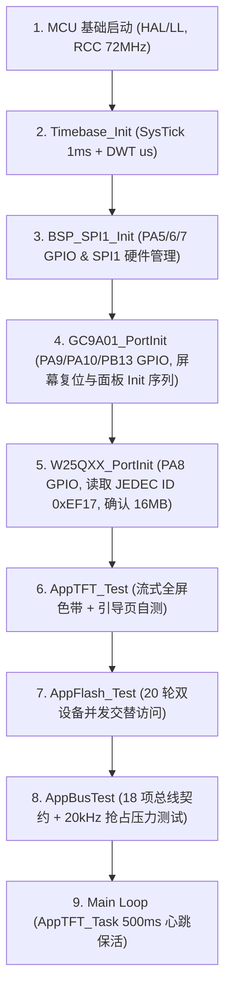

# STM32F103C8T6 硬件引脚与总线配置说明书

## 一、硬件引脚接线核对

经全面审计工程源码（`BSP/Src/gc9a01_port.c`、`BSP/Src/w25qxx_port.c`、`BSP/Src/bsp_spi.c`、`Core/Src/main.c`）及其实机工作验证，确认当前实际硬件连接定义如下：

| 设备 | 信号名称 | MCU 物理引脚 | GPIO 模式 | 速率 / 特性 | 备注说明 |
|:---:|:---:|:---:|:---:|:---:|:---|
| **SPI1 总线** | **SCK** | **PA5** | 复用推挽输出 (AF-PP) | 50 MHz (High Speed) | SPI1 共享时钟线 |
| **SPI1 总线** | **MISO** | **PA6** | 浮空输入 / 上拉输入 | 50 MHz (High Speed) | SPI1 共享主入从出线 |
| **SPI1 总线** | **MOSI** | **PA7** | 复用推挽输出 (AF-PP) | 50 MHz (High Speed) | SPI1 共享主出从入线 |
| **GC9A01 TFT** | **CS** | **PA9** | 通用推挽输出 | 50 MHz (High Speed) | 低电平有效片选 |
| **GC9A01 TFT** | **RST** | **PA10** | 通用推挽输出 | 50 MHz (High Speed) | 低电平复位脉冲 |
| **GC9A01 TFT** | **DC** | **PB13** | 通用推挽输出 | 50 MHz (High Speed) | 0=命令 (CMD), 1=数据 (DATA) |
| **GC9A01 TFT** | **BLK** | 悬空 / 3.3V | — | 常亮 | 背光未接 MCU 控制引脚 |
| **W25Q128 Flash** | **CS** | **PA8** | 通用推挽输出 | 50 MHz (High Speed) | 低电平有效片选 |
| **板载 LED** | **LED** | **PC13** | 通用推挽输出 | 2 MHz (Low Speed) | 低电平点亮（BluePill 默认） |
| **按键 1** | **KEY1** | **PB12** | 上拉输入 | — | 用户输入按键 |
| **按键 2** | **KEY2** | **PB14** | 上拉输入 | — | 用户输入按键 |

> [!IMPORTANT]
> **历史接线说明与纠正**：
> 在部分早期报告草稿中曾出现过 `PA4 (TFT_CS), PA2 (TFT_DC), PA1 (TFT_RES), PB0 (FLASH_CS)` 等临时测试记录。经实机硬件与源码对比确认，**工程基准配置自始至终均为 `TFT_CS=PA9, TFT_RST=PA10, TFT_DC=PB13, FLASH_CS=PA8`**，不得擅自按早期错误报告修改代码引脚。

---

## 二、MCU 时钟树与总线频率配置

系统基于 8.0 MHz 外部高速晶振（HSE）经 PLL 9 倍频倍增：

| 时钟域 | 来源 / 分频比 | 工作频率 | 服务外设与说明 |
|:---:|:---:|:---:|:---|
| **OSC_IN / HSE** | 外部有源/无源晶体 | 8.0 MHz | 基础时钟源 |
| **SYSCLK** | HSE × PLL (×9) | **72.0 MHz** | 系统核心主频 |
| **HCLK (AHB)** | SYSCLK / 1 | **72.0 MHz** | Cortex-M3 内核、DMA1、SRAM (20KB)、Flash (64KB) |
| **PCLK1 (APB1)** | HCLK / 2 | **36.0 MHz** | 低速外设（TIM2..4、SPI2、USART2..3） |
| **PCLK2 (APB2)** | HCLK / 1 | **72.0 MHz** | 高速外设（SPI1、GPIOA..E、ADC1..2、TIM1） |

---

## 三、SPI1 共享总线参数配置

SPI1 挂载于 APB2 高速总线（72 MHz），通过 `spi_bus_acquire()` 在不同设备介入时动态切换总线分频与模式：

| 设备名称 | 协议模式 | 时钟分频 | 实际 SPI 频率 | DMA 支持 | 说明 |
|:---:|:---:|:---:|:---:|:---:|:---|
| **GC9A01 (TFT)** | Mode 0 (CPOL=0, CPHA=0) | `/4` (72 MHz / 4) | **18.0 MHz** | 启用 DMA | 屏幕高刷需求 |
| **W25Q128 (Flash)** | Mode 0 (CPOL=0, CPHA=0) | `/8` (72 MHz / 8) | **9.0 MHz** | 启用 DMA | 兼顾 Flash 信号完整性与长导线稳定性 |

---

## 四、DMA 通道映射与调度阈值

DMA 控制器配置使用 DMA1：

| 外设接口 | DMA 请求通道 | 优先级 | 数据位宽 | 内存递增 | 外设递增 | 循环模式 |
|:---:|:---:|:---:|:---:|:---:|:---:|:---:|
| **SPI1_TX** | **DMA1 Channel 3** | Medium | 8-bit | 启用 | 禁用 | 禁用 (单次) |
| **SPI1_RX** | **DMA1 Channel 2** | High | 8-bit | 启用 | 禁用 | 禁用 (单次) |

**传输门限策略**：
- **短数据包（< 16 字节）**：采用 CPU 轮询模式（移位寄存器直发），消除 DMA 通道配置与中断上下线开销。
- **长数据包（$\ge$ 16 字节）**：自动切换为 DMA 模式（Channel 3 发送，Channel 2 接收），极大释放 CPU 负载并提升吞吐率。

---

## 五、外设初始化依赖顺序

系统上电初始化严格遵循依赖倒置与分层启动原则：

